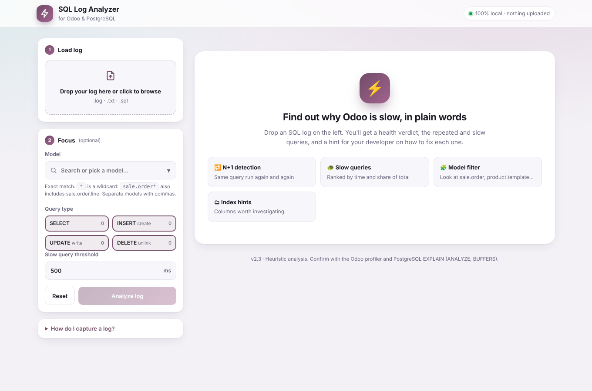
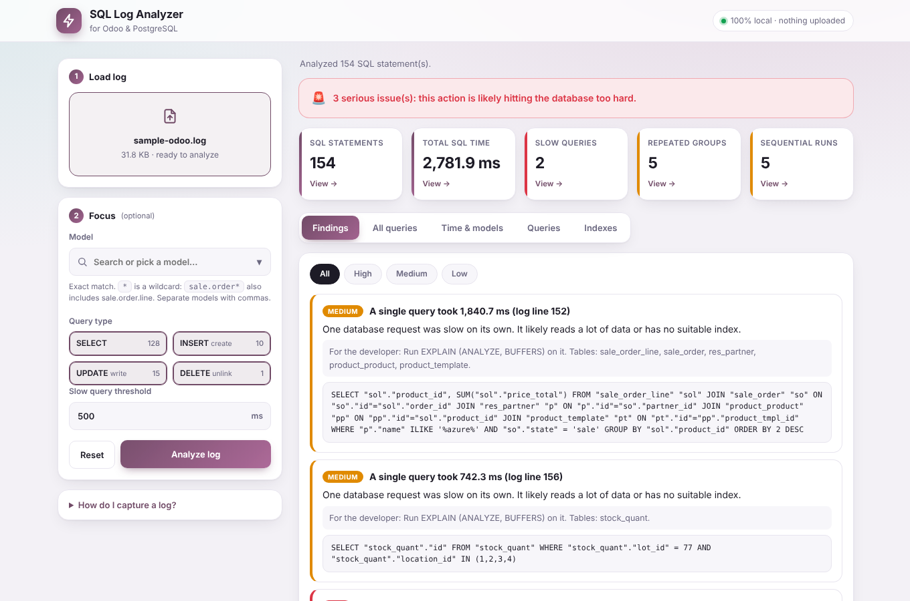
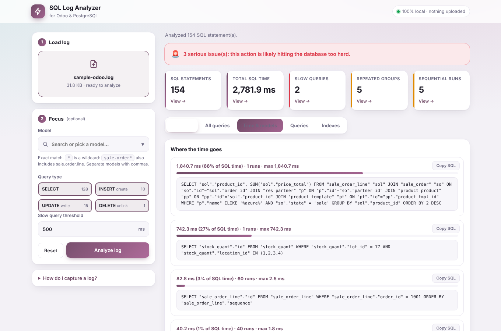
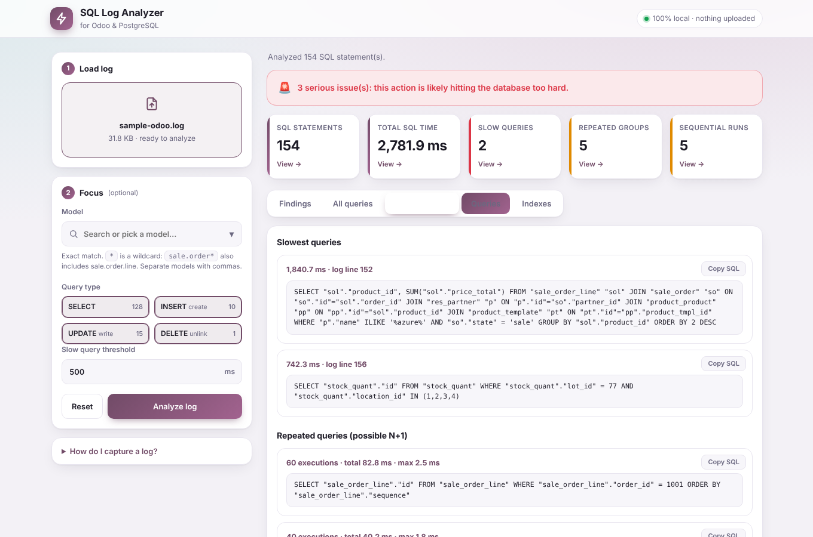
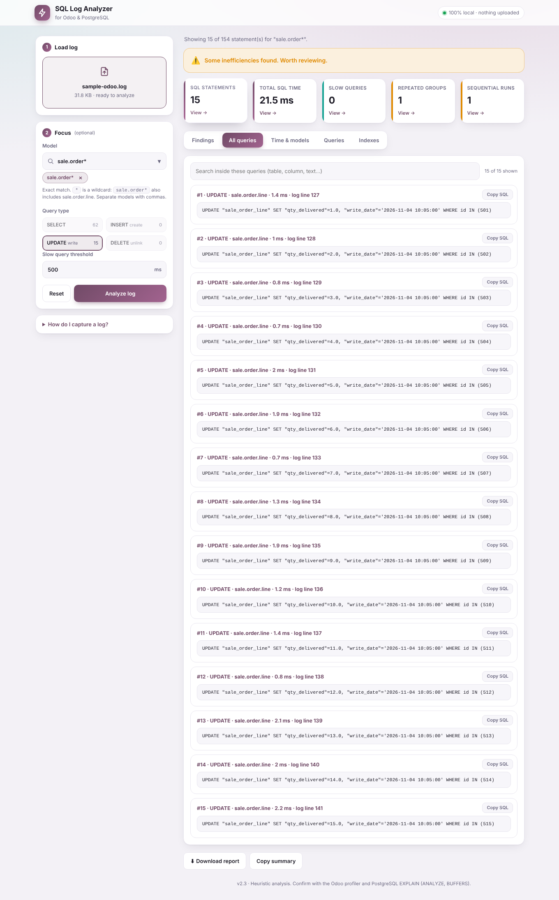
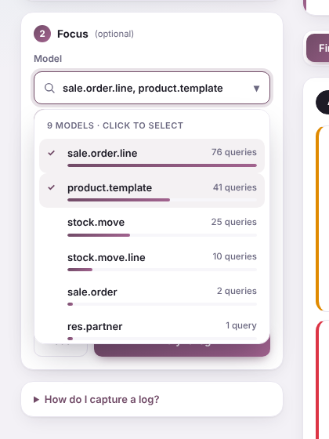
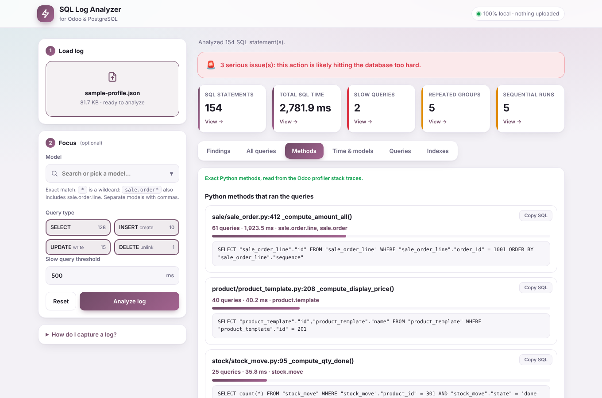
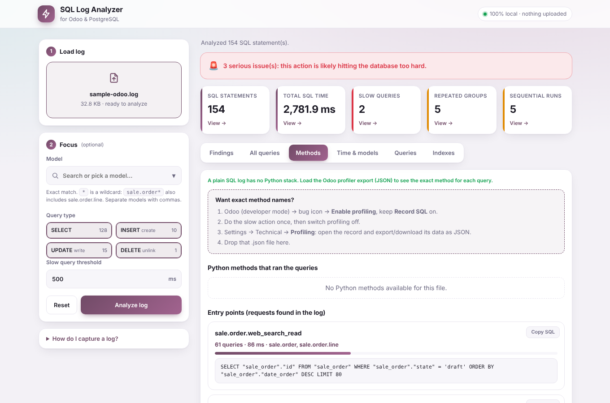
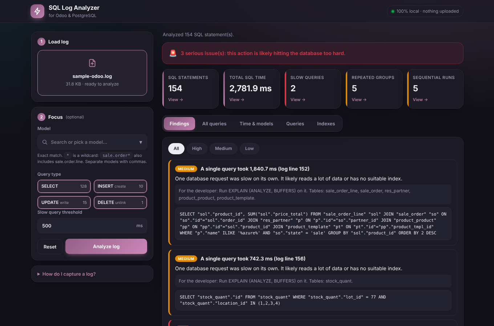

# Odoo SQL Log Analyzer

A Chrome extension that turns raw Odoo / PostgreSQL SQL logs into plain-language performance findings. It is built so functional team members can read the results, and developers get a hint on where to look next.

**Everything runs locally in your browser. Your log is never uploaded anywhere, and the extension requests no permissions.**

---

## Screenshots

*Captured from the real extension using the included `samples/sample-odoo.log` (synthetic data).*

**1. Start screen: load a log on the left, results appear on the right**



**2. Findings: verdict, clickable metric cards, plain-language explanations**



**3. Time & models: where the time goes and queries per model (click a model to filter)**



**4. Queries: slowest, repeated (N+1), back-to-back, heavy shapes**



**5. Model filter + query type: `sale.order*` with only UPDATE ticked, opened from the "SQL statements" card**



**6. Model dropdown: search, see query counts, tick several models**



**7. Methods tab with an Odoo profiler file: exact Python method behind each query**



**8. Methods tab with a plain log: the request (RPC call) that triggered each group of queries**



**9. Dark mode: follows your system theme automatically**



---

## Finding the method name behind a query

A plain SQL log only contains SQL, so there are three levels of answer, from exact to approximate. The **Methods** tab shows whichever your file allows, and the same information is added to the "For the developer" line of each finding and to every row in **All queries**.

| Level | Input file | What you get |
|---|---|---|
| 1. Exact | Odoo **profiler** export (`.json`) with *Record SQL* on | The Python method that ran the query, e.g. `sale/sale_order.py:412 _compute_amount_all()`, plus the calling chain |
| 2. Entry point | Normal Odoo log containing request lines | The RPC call that triggered the queries, e.g. `sale.order.web_search_read`, `stock.move._action_done` |
| 3. Estimate | Any log | The likely ORM operation: `create()`, `write()`, `unlink()`, `search()`, `search_count() / _read_group()`, `browse().field` |

Click any method or entry point title to jump to **All queries**, filtered to exactly the queries it ran.

**How to get the exact method (level 1)**
1. In Odoo, open developer mode, click the bug icon and **Enable profiling** (keep **Record SQL** on).
2. Do the slow action once, then switch profiling off.
3. Open Settings > Technical > **Profiling**, open the record, and export its data as JSON.
4. Drop that `.json` file on the analyzer.

The profiler stores each query with its Python stack trace (see Odoo's *Performance > Profiling* documentation). The analyzer skips Odoo framework frames (ORM, `sql_db`, `http`…) and reports the nearest frame in your addons, so you see the business method rather than `search()` or `execute()`.

**How level 2 works:** Odoo writes the request line *after* the queries of that request, so the queries since the previous request line are attributed to it. Reproduce one action at a time on a quiet server, otherwise requests from several users can interleave in the log.

---

## What it detects

| Area | How it is detected |
|---|---|
| Slow SQL queries | Queries with `duration` at or above the slow threshold (default 500 ms), ranked by duration |
| Repeated SQL / N+1 | Queries with the same shape (values replaced by `?`) executed 5 or more times |
| Query count by model | Every table is mapped to a model name (`sale_order_line` becomes `sale.order.line`) and counted |
| Large total duration | Top query patterns by total time and their share of all SQL time |
| Sequential queries | 5 or more identical queries back-to-back, with the starting log line |
| Large JOIN / GROUP BY | 4+ JOINs, 2+ subselects, GROUP BY over several tables, or ORDER BY without LIMIT on joined queries |
| Missing indexes | Columns filtered on in slow or repeated queries are listed as candidates to investigate |
| Queries inside loops | Repeated queries are classified as create-in-loop, write-in-loop, `search_count` in loop, browse-by-id, or search-in-loop, each with a fix hint |

Indexes are suggestions to investigate with `EXPLAIN`, not proof that an index is missing.

---

## Install

1. Put these files in one folder: `manifest.json`, `background.js`, `popup.html`, `popup.js`, `popup.css`.
2. Open `chrome://extensions`.
3. Turn on **Developer mode** (top right).
4. Click **Load unpacked** and choose the folder.
5. Click the extension icon. The analyzer opens in a **full browser tab**. It does not use the small popup, because Chrome closes popups when the file picker opens.

**After changing any file**, click the reload icon on the extension card at `chrome://extensions`. Always replace **all** files together, not just one.

---

## How to capture a good log

**Odoo SQL log (shows the queries):**
```
odoo-bin ... --log-level=debug_sql
```
or `--log-handler=odoo.sql_db:DEBUG`

**PostgreSQL slow-query log (adds timings):**
```
log_min_duration_statement = 100   # ms; reload PostgreSQL afterwards
```
Lines such as `duration: 512.3 ms statement: SELECT ...` are read automatically.

Tips:
- Reproduce **one** slow action only (one screen, one button, one report) so the log stays focused.
- Without `duration: ... ms` values the tool still finds repeated, sequential and heavy-shape problems, but slow-query and time-share checks show `n/a` / `0`.

---

## Using the tool

0. *Try it first:* load `samples/sample-odoo.log` to see every feature without using your own data.
1. **Choose the file**: drag a `.log`, `.txt`, `.sql` or profiler `.json` file onto the drop zone, or click it to browse.
2. **(Optional) Model filter**: click the Model box to open the dropdown. It lists every model found in your log, busiest first, with its query count and a small bar.
   - Type to search the list (e.g. `stock` shows only stock models).
   - Click one or more models to tick them (✓). Chosen models appear as chips under the box; click × on a chip to remove it.
   - Keyboard: ↑ ↓ to move, Enter to select, Esc to close.
   - Exact match by default: `sale.order` shows only the `sale_order` table.
   - Wildcard: `sale.order*` also includes `sale.order.line`.
   - Several models: separate with commas, e.g. `product.template, sale.order`.
   - You can also click any model name in **Time & models > Queries per model**.
3. **(Optional) Query type**: tick or untick **SELECT**, **INSERT (create)**, **UPDATE (write)**, **DELETE (unlink)**. Each shows how many queries of that type exist for the current model. Odoo's `unlink()` runs as SQL `DELETE`, so there is no separate unlink type. Queries starting with `WITH` count as SELECT.
4. **Set the slow threshold** (ms) if 500 is not right for you.
5. Click **Analyze**. Changing the model, type or threshold re-runs instantly without re-reading the file.

### Reading the results

- **Verdict banner**: green (healthy), amber (inefficiencies), red (serious issues).
- **Metric cards** (clickable):
  - *SQL statements* opens **All queries**
  - *Total SQL time* opens **Time & models**
  - *Slow queries / Repeated groups / Sequential runs* open **Queries**, scrolled to that section
- **Tabs**
  - **Findings**: plain-language explanation plus a "For the developer" hint. Filter by High / Medium / Low.
  - **All queries**: every query in the current view, numbered, with type, model, duration, log line, a search box and Show more paging (100 first, then 200 at a time).
  - **Time & models**: where the time goes, and queries per model with bars.
  - **Queries**: slowest, repeated, back-to-back, and heavy-shape queries.
  - **Indexes**: columns to investigate.
- **Copy SQL** on any query card, **Copy summary** for pasting into a ticket, **Download report** for a `.txt` file.

### Severity rules

| Finding | High when |
|---|---|
| Slow query | Duration is at least 5x the threshold (otherwise Medium) |
| Repeated query | 50+ executions, or total time at or above the threshold (otherwise Medium) |
| Sequential run | 30+ identical queries in a row (otherwise Medium) |
| Heavy shape | Always Medium |
| Index candidate | Always Low |

The verdict is red if any finding is High, amber if any is Medium, otherwise green.

---

## Files

| File | Purpose |
|---|---|
| `manifest.json` | Chrome Manifest V3 definition. No popup, no permissions. |
| `background.js` | Opens `popup.html` in a new tab when the icon is clicked |
| `popup.html` | The page layout |
| `popup.css` | Styling, including automatic dark mode |
| `popup.js` | Log parser, analysis engine, rendering, filters |
| `samples/sample-odoo.log` | Synthetic log to try the tool (N+1, slow JOIN/GROUP BY, inserts, updates, request lines) |
| `samples/sample-profile.json` | Synthetic profiler-style export with Python stack traces, to try the exact-method view |
| `docs/images/` | Screenshots used in this README |

---

## How parsing works

- A new log record starts at a line beginning with a timestamp (`YYYY-MM-DD hh:mm`), a line containing `duration: ... ms`, or a line starting with `SELECT / INSERT / UPDATE / DELETE / WITH`. Other lines are treated as continuation of the previous record (multi-line SQL).
- The SQL is taken from after a marker such as `statement:`, `query:` or `execute <name>:`.
- Queries are **normalised** for grouping: string literals, numbers and parameters (`%s`, `$1`) become `?`, and `IN (?, ?, ?)` lists collapse to `(?)`.
- Tables are read from `FROM`, `JOIN`, `UPDATE` and `INTO`. A query touching several tables counts for every model involved.

---

## Limitations

- A plain SQL log has no Python call stacks, so it can name the **model** and (from request lines) the **entry-point call**, but not the inner Python method. Load the Odoo profiler export for exact methods (see "Finding the method name").
- The profiler import reads the common shapes of the export (entries with `query` / `full_query`, `time` in seconds, and a `stack` list of frames). Odoo versions differ; if your export is not recognised, the tool falls back to log parsing. Send a trimmed sample and the parser can be adjusted.
- Model names are guessed from table names by replacing `_` with `.`. Models whose real names contain underscores may display slightly differently.
- SQL extraction is heuristic. Unusual log formats may be missed; if "No SQL statements recognised" appears, check the log level.
- Findings are hints. Confirm with `EXPLAIN (ANALYZE, BUFFERS)` on a safe reproduction before changing indexes or code.
- Very large logs are handled, but the All queries list is paged to keep the page responsive.

---

## Troubleshooting

| Problem | Fix |
|---|---|
| File picker closes the window or nothing happens | Use the full-tab version (this one). Make sure `manifest.json` has no `default_popup`. |
| Red message: "popup.html is out of date (missing: ...)" | `popup.html` and `popup.js` are from different versions. Replace **all** files, then reload the extension. |
| `Cannot read properties of null` | Same cause as above. |
| "Could not load icon" at `chrome://extensions` | Remove the `icons` block from the manifest, or add the PNG files it points to. |
| Total SQL time shows `n/a`, Slow queries shows `0` | The log has no `duration: ... ms` values. Enable `log_min_duration_statement`. |
| Methods tab says "A plain SQL log has no Python stack" | Expected for a normal log. Load the profiler `.json` export for exact methods. |
| "No SQL statements recognised" | Enable `--log-level=debug_sql`, or check that the file is the right log. |
| Report text has literal `\n` | You are on an old `popup.js`. Replace it. |
| Changes do not appear | Reload the extension at `chrome://extensions` and refresh the analyzer tab. |

---

## Common fixes the findings point to

| Pattern in the log | Typical Odoo fix |
|---|---|
| Same `SELECT ... WHERE id = ?` many times | `browse(ids)` once, or prefetch before the loop |
| Same `SELECT ... WHERE field = ? LIMIT 1` many times | One `search()` with `('field', 'in', ids)`, then group in Python |
| Repeated `COUNT(*)` | `_read_group()` instead of `search_count()` inside a loop |
| Many single-row `INSERT` | `create()` with a list of dicts |
| Many single-row `UPDATE` | One `write()` on the whole recordset |
| Slow query with a filter column | Check the plan; consider `index=True` on the field |
| `ILIKE '%text%'` on a big table | Consider a `pg_trgm` GIN index, or avoid contains-search |
| Heavy GROUP BY / many JOINs | Narrow the domain, use a stored computed field, or a SQL view for reports |

---

## Privacy

The log is read with the browser's `File` API and analysed in memory on your machine. There are no network requests, no external scripts, no analytics, and no stored data. Closing the tab discards everything.

---

## Version history

- **2.4** Methods tab: exact Python method per query from the Odoo profiler JSON, entry-point (RPC call) detection from request lines in normal logs, ORM-operation estimate, method names added to findings and All queries, `.json` upload.
- **2.3** Custom model dropdown (search, counts, bars, multi-select, chips, keyboard support) replacing the browser's built-in list.
- **2.2** New dashboard UI: sticky control sidebar, welcome screen, pill tabs, gradient cards, pill-style query-type toggles, refreshed dark mode.
- **2.1** Redesigned UI (drop zone, tabs, severity chips, dark mode, bars), model filter, query-type filter, clickable metric cards, All queries tab with search and paging, Copy SQL.
- **2.0** Full analysis engine: slow, N+1, sequential, heavy shapes, index candidates, plain-language findings. Runs in a full tab.
- **1.0** Initial popup version.
